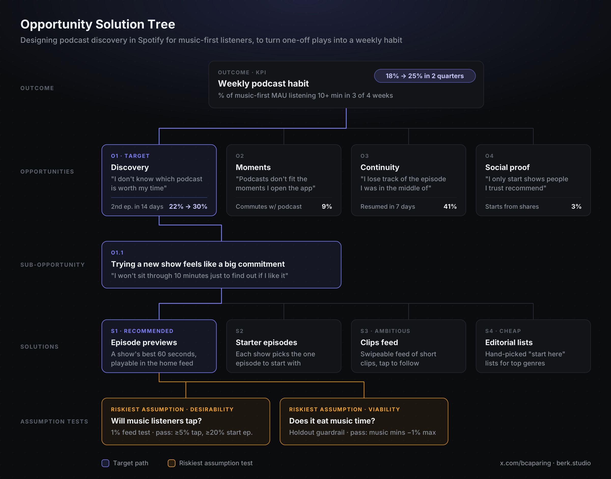

# Product Management Skills for Claude

Claude skills for product leaders who are short on time. Each skill encodes one PM workflow end to end: it asks for the context it needs, applies a proven framework, challenges the result, and hands back something you can use in a meeting today.

Built for the reality of an early-stage (seed to Series B) product team: small team, little data, lots of decisions.

## Skills

| Skill | What it does | Try it with |
|---|---|---|
| [`opportunity-solution-tree`](skills/opportunity-solution-tree/SKILL.md) | Builds an Opportunity Solution Tree from interview transcripts, raw notes, data or just a goal, attaches a KPI to the outcome and leading indicators to opportunities, compares opportunities to pick a target, breaks solutions into assumptions and designs tests. RICE/ICE for solutions. | "Here are 6 interview transcripts, build our OST for activation." |
| [`stakeholder-update`](skills/stakeholder-update/SKILL.md) | Turns messy notes into a bottom-line-up-front update for the CEO, board, team, sales or customers. Outcomes over activity, honest status, one clear ask. | "Write my Friday update for the CEO from these notes." |
| [`user-interview-synthesis`](skills/user-interview-synthesis/SKILL.md) | Interview snapshots and cross-interview synthesis: evidence-counted themes, verbatim quotes, JTBD, and opportunities in customer voice that drop straight into the OST. | "Synthesize these 8 interview transcripts." |
| [`unslop`](skills/unslop/SKILL.md) | Cuts long, AI-generated PRDs down to the decisions, numbers and open questions. Strips filler and rhetorical tics, never invents metrics, and turns every missing decision into an open question. Ends with a word-count report. | "Unslop this PRD." |

They chain: **interviews → opportunities → OST → tests → stakeholder update.**

## Example

A classic product sense question ("get more music listeners into a weekly podcast habit") worked through end to end: [examples/opportunity-solution-tree.md](examples/opportunity-solution-tree.md)



An AI-written iPad calculator PRD before and after `unslop`: 1,033 → 658 words, nothing invented, 12 open questions the original never asked: [examples/unslop.md](examples/unslop.md)

## Design principles

- **Ask before answering.** Each skill checks for the context it needs (outcome, audience, research question) and asks at most three questions before working.
- **Never invent evidence.** No made-up quotes, numbers, baselines or dates. Gaps become `[TBD]` or `[assumed]`.
- **Challenge pass.** Every skill reviews its own output as a skeptical head of product and reports the most important issues under "Pushback" or "Caveats".
- **Scores inform, the PM decides.** Frameworks produce inputs, never the decision.
- **Quick-pass mode.** Say "quick" and you get the three things that matter.

## Install

### Claude.ai (web, desktop, mobile)

1. Download this repo as a zip, or zip a single skill folder (e.g. `skills/stakeholder-update/`).
2. In Claude's **Settings**, open the **Skills** section and upload the zip.
3. Start a chat and just describe the task. The skill activates on its own.

Team and Enterprise plans: an org owner can add skills for the whole organization.

### Claude Code

```bash
git clone https://github.com/berkcapar/product-management-skills.git
cp -r product-management-skills/skills/* ~/.claude/skills/
```

Or copy into a project's `.claude/skills/` folder to scope them to that project.

## Roadmap

- `kpi-setting`: North Star and metric tree with definitions, owners and targets
- `prd-writer`: short, decision-focused PRDs
- `decision-memo`: options, trade-offs, recommendation
- `quarterly-planning`: bets and OKRs for the quarter
- `experiment-design`: hypothesis, metric, sample, stopping rule

Ideas and PRs welcome.

## Credits

Frameworks drawn from Teresa Torres (*Continuous Discovery Habits*, Opportunity Solution Trees), Intercom (RICE), Sean Ellis (ICE), Clayton Christensen and Bob Moesta (Jobs to be Done), David Bland (assumption mapping), and Eric Ries (*The Lean Startup*, leap-of-faith assumptions).

## License

MIT

## Author

Built by Berk Capar: [x.com/bcaparing](https://x.com/bcaparing) · [berk.studio](https://berk.studio)
