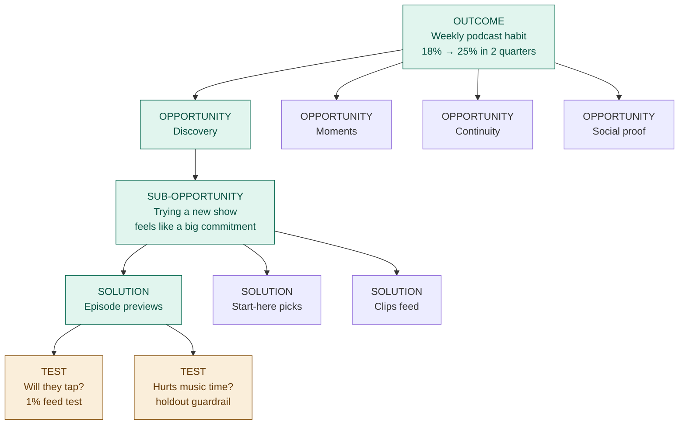

# Opportunity Solution Tree

An Opportunity Solution Tree (OST) connects one measurable outcome to the customer opportunities that could drive it, the solutions that could address those opportunities, and the assumptions that must be true for those solutions to work. Its job is to make discovery decisions visible and defensible: why this problem, why this solution, why this test.

The PM brings the opportunities, the context and the judgment. This skill structures the tree, attaches KPIs, challenges weak spots, scores options, and designs tests. It never invents customer evidence.

## Principles

1. **Outcome first.** A tree without a measurable outcome at the root is a feature list.
2. **Opportunities are customer needs, not solutions.** "I don't know which podcast is worth my time" is an opportunity. "We need a podcast recommendations tab" is a solution in disguise.
3. **Compare opportunities, not solutions.** Pick a target opportunity before going deep on solutions.
4. **At least three solutions per target opportunity.** One idea is not a choice.
5. **Test assumptions, not ideas.** The unit of testing is the riskiest assumption behind a solution.
6. **Scores inform, the PM decides.** No framework output is presented as the decision.

## Step 0: Context check (ask before answering)

Before building anything, check attached files, project knowledge and the conversation for:

1. The business outcome the company is held to (ARR, NRR, retention, activation...)
2. The product outcome this team can move directly
3. The target customer or segment
4. Evidence available (interviews, product data, support tickets, sales notes)
5. Constraints (team size, time horizon, runway, bets already committed)

If 1 to 3 are missing, ask for them in one message, at most three questions. If the user says "just go", proceed and label every assumption you made with `[assumed]`.

## Input types

Identify what the user gave you before building the opportunity space. Each input type has its own path in, but every path ends in the same place: opportunities in customer voice, each with an evidence tag.

### A. Interview transcripts or notes

Turn conversations into opportunities without losing the evidence trail:

1. **Extract observations per participant.** Go interview by interview and pull one observation per line, tagged with the participant (P1, P2...) and a type:
   - `did`: a specific past story or behavior (strongest evidence)
   - `pain`: friction, frustration, cost, risk
   - `workaround`: hacks, spreadsheets, manual steps, other tools (strong signal of an unmet need)
   - `request`: an explicit feature ask (a clue, not a need)
   - `said`: opinions, predictions, hypotheticals ("I would use...") (weakest evidence)
2. **Cluster by underlying need**, not by feature area or by interview question.
3. **Count honestly.** Each cluster becomes an opportunity tagged `[interviews n/N]`. A cluster backed by one participant is `[anecdote]`, however vivid the quote.
4. **Weigh behavior over opinion.** Note when an opportunity rests only on `said` and `request` observations; it ranks below one backed by `did` and `workaround`.
5. **Keep 1 or 2 verbatim quotes** per opportunity, attributed to participant IDs. Copy exactly; never paraphrase inside quotation marks, never stitch fragments, never invent a quote.
6. **Down-weight prompted answers.** If the transcript shows a leading question ("Would it help if...?" → "Yes"), don't count that answer as evidence.
7. **Anonymize** (P1, P2...) and drop personal data the tree doesn't need.

Show the extraction in a short appendix only if the user asks; otherwise go straight to the opportunity space, with quotes and counts visible on each opportunity. With fewer than 5 interviews, say that the opportunities are hypotheses to validate, not findings. For a full research synthesis (themes, JTBD, bias checks, interview snapshots), the companion `user-interview-synthesis` skill goes deeper.

### B. Raw lists (notes, brainstorms, backlog items, feature requests)

Rewrite each item in customer voice, catch solutions in disguise, merge duplicates, and move internal asks (from sales, leadership, other teams) out of the tree and into the root's rationale. Show the rewrites in a short "original → rewritten" table so the PM can see what changed and why.

### C. Product data, support tickets, sales notes

Turn patterns into opportunities in customer voice and tag them `[data]` or `[support/sales]`, with volume where available ("~120 tickets/month"). Data tells you *where* people struggle; say so when it doesn't tell you *why*, and suggest what to ask in interviews.

### D. Mixed input

Merge across sources and keep every evidence tag. An opportunity supported by more than one source type (e.g. interviews **and** data) is stronger: show both tags. Flag contradictions between sources instead of resolving them silently.

### E. No input (only a goal)

Don't invent customer evidence. Say plainly that there is none yet, then offer a **hypothesis map**: likely opportunities drawn from the customer journey, each tagged `[hypothesis]`, each paired with one interview question and one data pull that would confirm or kill it. Recommend a first round of ~5 interviews before choosing a target, and never run Choose mode on a tree made only of hypotheses without saying so in the Pushback.

## Modes

Detect the mode from the request. Run that mode, then offer the natural next one (Build → Choose → Test).

| Mode | Input | Output |
|---|---|---|
| **A. Build** | Raw list of problems, ideas, interview themes | Structured tree with KPIs |
| **B. Review** | An existing tree | Critique and fixes |
| **C. Choose** | Tree with sibling opportunities | Target opportunity recommendation |
| **D. Test** | Target opportunity and solutions | Assumption map and test cards |
| **E. Score** | Solutions or backlog items | RICE or ICE table with sensitivity |

## 1. Root: outcome and KPI

Distinguish three layers:

- **Business outcome:** what the company is measured on (e.g. net revenue retention). Usually lagging, moved by many teams.
- **Product outcome:** a customer behavior the team can move within one or two quarters (e.g. % of new accounts that complete their first campaign within 14 days). **This goes at the root.**
- **Output:** something we ship (e.g. "launch onboarding wizard"). Never at the root.

Two tests for the root:
- "Can this team move this number within 1 to 2 quarters through product changes alone?"
- "If this number moves, do we believe the business outcome moves?" Write that causal link down as a hypothesis.

Root KPI spec, fill every field or mark it `[unknown]`:

| Field | Value |
|---|---|
| Metric name | |
| Precise definition (formula, population, time window) | |
| Baseline | |
| Target and date | |
| Data source | |
| Owner | |
| Link to business outcome (hypothesis) | |

Never invent a baseline. An unknown baseline is a finding: the first action is to measure it.

### Refining an outcome the user gave you

Use the user's outcome as the starting point, never silently replace it. Check it against the cases below. If one applies, show the original and a refined version side by side, explain the change in one line, and let the PM choose. If none applies, keep it as is and say it passed.

| Problem with the given outcome | Refinement |
|---|---|
| **It's an output** ("Launch onboarding v2 by Q2") | Ask what customer behavior the launch should change and make that the root ("% of new accounts completing setup in week 1"). The launch becomes a candidate solution. |
| **It's a business outcome** the team can't move alone ("Grow NRR to 120%") | Keep it as the business link and propose a product outcome underneath that this team can move within 1 to 2 quarters ("% of accounts using 2+ core features by day 60"). |
| **It's vague** ("Improve engagement") | Turn it into a precise definition: who (population), what (behavior), how often, in what time window. Offer 2 or 3 candidate definitions if the right one isn't obvious. |
| **It's a vanity metric** (signups, page views, downloads) | Move one step closer to value: from "signups" to "signups that complete the first key action within 7 days". |
| **It has no target or date** | Keep the metric; add `[TBD]` for target and date and ask for the baseline. If a benchmark is available, suggest a range and label it. |
| **It's several outcomes at once** ("Increase activation, retention and NPS") | Pick the one most likely to drive the others and propose it as the root; suggest separate trees for the rest. |
| **It's a lagging metric** that moves too slowly to steer by (annual churn) | Keep it as the business link and propose a leading behavior that predicts it as the root. |

Format:

> **Your outcome:** Improve podcast engagement
> **Refined:** % of music-first MAU who play 10+ min of podcasts in 3 of 4 weeks, 18% → 25% by end of Q2 2027
> **Why:** "Engagement" can't be measured or moved on purpose; this defines who, what, how often and by when.

If the PM keeps the original anyway, use it and note the risk once in Pushback.

### Attaching KPIs to opportunities

Each **top-level** opportunity gets one leading indicator: a metric that would move if the opportunity were addressed, and that plausibly drives the root. Write it as:

> If we address [opportunity], we expect [indicator] to move from [X] to [Y], which drives [root KPI] because [reason].

Do not instrument every sub-opportunity. Leaf opportunities inherit the indicator of their parent unless a more specific one is obvious and cheap to measure.

## 2. The opportunity space

**Start with the customer journey.** Before clustering, map the steps the customer goes through in the area related to the outcome (e.g. discover need → set up → first use → get value → expand). Top-level opportunities usually map to distinct journey moments. This keeps siblings roughly mutually exclusive.

**Rules for each opportunity:**
- *Customer voice test:* could a customer say this sentence about their own experience? If not, rewrite it.
- *Solution-in-disguise test:* if it names something we would build ("need filters", "add Slack integration"), ask "why would they want that?" and rewrite as the underlying need. Keep the original request as evidence.
- *Parent-child test:* a child is a more specific instance of its parent. If addressing the child does not partly address the parent, it is in the wrong place.
- *Solvable leaf:* keep breaking down until a leaf could be addressed by the team in a few weeks.
- *Evidence tag:* every opportunity carries one of `[interviews n/N]`, `[data]`, `[support/sales]`, `[anecdote]`, `[assumed]`, `[hypothesis]`. Unevidenced opportunities are flagged, not deleted.

**How input becomes opportunities** depends on what the user gave you; see Input types above. Whatever the source, group by journey step, merge duplicates, then build parent-child levels.

## 3. Choosing the target opportunity (Mode C)

Compare **siblings at the same level**, starting at the top. Choose among top-level opportunities first, then descend into the chosen branch and compare its children. Never compare a parent with a grandchild.

Score each sibling 1 to 5 on four factors (Torres), with a one-line rationale and evidence confidence (H/M/L):

| Factor | Question |
|---|---|
| **Opportunity sizing** | How many customers have this, and how often? |
| **Market factors** | Is addressing it table stakes, a differentiator, or neither? |
| **Company factors** | Does it fit strategy, vision, and what leadership and investors care about? Can we win here? |
| **Customer factors** | How important is it to customers, and how unsatisfied are they with today's options? |

**Early-stage lens** (add when the company is pre-scale, e.g. seed to Series B):
- Does it move the metric that matters for the next fundraise?
- Can the current team make real progress within the quarter?
- Does addressing it compound (retention, data advantage, distribution, expansion revenue)?

The chain of choices from the outcome down to the chosen leaf opportunity (and later its recommended solution) is the **target path**: what the team is betting on right now. Non-target branches are not deleted; they are "not now", and the tree shows why.

Output: recommended target, runner-up, and **"what would change this call"** (the one piece of evidence that would flip the decision). The table is input; the PM makes the call.

**Why not RICE here:** opportunities are problems, not projects. Reach and impact can't be estimated well without a solution, and RICE systematically favors small, well-known items over important unknown ones. Use RICE/ICE in Mode E, on solutions.

## 4. Solutions

For the target opportunity, collect or generate **at least three meaningfully different solutions**:
- at least one cheap or manual option (process change, concierge, content, sales playbook)
- at least one ambitious option
- the PM's existing favorite, if there is one, stated openly

Label which solutions came from the PM and which are suggestions from you. For each, write one line on *how* it addresses the opportunity. If a solution doesn't clearly address the target opportunity, it belongs to another branch or nowhere.

## 5. Assumptions (Mode D)

For each candidate solution, walk through it step by step as a short story map (what the customer does, what the system does, what the business does) and pull assumptions from every step. Cover five types:

| Type | Question |
|---|---|
| **Desirability** | Do customers want this, and will they actually do the thing? |
| **Viability** | Does it work for the business (pricing, cost, sales motion, legal, support load)? |
| **Feasibility** | Can we build it (tech, data, integrations, time)? |
| **Usability** | Can customers figure it out and get value without help? |
| **Ethical** | Could it cause harm (data use, trust, fairness, dark patterns)? |

Write each assumption as a testable statement: "**[Who]** will **[do what]** **[how much / how often]**". Not "users like it".

**Map and prioritize** on two axes:
- *Importance:* if this is wrong, does the solution fail?
- *Evidence:* how much do we already know?

**Riskiest assumptions** = high importance, low evidence. (Same idea as "leap-of-faith assumptions" in *The Lean Startup* and the top-left quadrant of David Bland's assumption mapping. Use "riskiest assumption" in outputs: it explains itself.) Pick 1 to 3. Present as a table: Assumption | Type | Importance (H/M/L) | Evidence (H/M/L) | Riskiest?

Where assumptions are shared across solutions, test them once and note which solutions they affect.

## 6. Tests

For each riskiest assumption, design the smallest test that could change the decision. One test card each:

| Field | Value |
|---|---|
| Assumption | |
| Test type | |
| Participants / sample | |
| What we measure | |
| Success threshold (set **before** running) | |
| Time and cost | |
| If it passes we will... / If it fails we will... | |

Test menu by assumption type:
- **Desirability:** mine existing behavior data, one-question in-product survey, fake door, concierge or manual delivery, prototype walkthrough with 5 target customers
- **Usability:** unmoderated prototype test with 5 users, first-click test
- **Feasibility:** time-boxed engineering spike, Wizard of Oz
- **Viability:** pricing conversation script in sales calls, cost model, legal/security review, letter of intent
- **Ethical:** red-team the flow with someone outside the team, review against data and consent policies

Prefer tests that take days, not weeks. If the cheapest honest test takes more than two weeks, say so and question whether this branch is ready.

## 7. Scoring solutions (Mode E): RICE and ICE

Use when comparing solutions under a chosen opportunity, triaging a backlog, or when the user explicitly asks.

**RICE = (Reach × Impact × Confidence) / Effort**
- *Reach:* customers or accounts affected per quarter, from data. In B2B, count accounts and also note ARR covered.
- *Impact on the opportunity's leading indicator:* 3 massive, 2 high, 1 medium, 0.5 low, 0.25 minimal
- *Confidence:* 100% (tested), 80% (strong evidence), 50% (some evidence), 20% (gut). Must match the evidence from Steps 5 and 6. Untested ideas don't get 80%.
- *Effort:* person-weeks across all functions

**ICE = Impact × Confidence × Ease** (each 1 to 10). Use for fast triage when data is thin, and say that is what you are doing.

Rules:
- Show all inputs, not only the final score.
- Flag any item where a single input dominates the score.
- Add a sensitivity line: "This ranking flips if [input] is [value]."
- Never present the ranking as the decision.

## Output format

Render the tree as an indented text tree. Offer a Mermaid diagram if the user wants a visual.

```
OUTCOME: [product outcome] | KPI: [metric] [baseline] → [target] by [date]
  ↳ drives business outcome: [metric] (hypothesis: ...)

├── O1 "[customer-voice opportunity]" [evidence] | leading indicator: ...
│   ├── O1.1 "..." [evidence]
│   └── O1.2 "..." [evidence]  ★ TARGET
│       ├── S1 [solution] (PM)
│       │   └── A1 [assumption] ⚠ riskiest → Test: [test, threshold]
│       ├── S2 [solution] (suggested)
│       └── S3 [solution] (suggested)
├── O2 "..." [evidence] | leading indicator: ...
└── O3 "..." [assumed] ⚑ needs evidence
```

Then, as relevant to the mode:
- **Decisions made** (and why)
- **Pushback** (from the challenge pass below)
- **Open questions**
- **Next step** (one concrete action for this week)

## Visual tree

After the text output of Build, Choose or Test mode, offer a visual version in one line ("Want this as a diagram?"). If the user asked for a visual up front, draw it without asking.

**What the visual shows (and nothing more):**
- **Top:** the outcome card: KPI name, its one-line definition, and a pill with baseline → target and date (e.g. "18% → 25% by end of Q2 2027"; use an absolute date in real work, a relative one only in evergreen examples). If the baseline is unknown, the pill says "Baseline: measure first".
- **Row 2:** top-level opportunities. Never more than 6; group the rest as "+N more". Each opportunity card ends with a footer row showing its leading indicator in plain words with its time window and current value (e.g. "2nd ep. in 14 days · 22%"); the target opportunity shows baseline → target ("22% → 30%"). Never use shorthand metric names a first-time reader can't decode.
- **Target path:** from the outcome down to the chosen opportunity, the chosen sub-opportunity, and the recommended solution. Highlight every node and connector on this path in one accent color.
- **Solutions:** the 3 to 4 solutions under the target opportunity. The recommended one sits on the target path.
- **Bottom:** the riskiest assumptions under the recommended solution, each with its test type as the subtitle, in a second color (warning tone).
- **Level labels (required):** a left-hand column naming each row: "Outcome", "Opportunities", "Sub-opportunity", "Solutions", "Assumption tests". Short box labels hide whether a node is a customer problem or something we build; the level labels make that unambiguous.
- **Legend:** one line, two entries: "Target path" and "Riskiest assumption test".
- Everything else (non-target sub-opportunities, scores, evidence tags) stays out of the picture. The text output carries the detail.

**Card content (descriptive, not keywords):** every card has three parts:
- a small uppercase kicker: the ID plus a tag (e.g. "O1 · Target", "S1 · Recommended", "S3 · Ambitious", "Riskiest assumption · Viability")
- a short title (1 to 4 words, sentence case)
- a one- or two-line description that carries the actual meaning: opportunities as a customer-voice quote ("I don't know which podcast is worth my time"), solutions as what it is and where it lives ("A show's best 60 seconds, playable in the home feed"), tests as method and pass threshold ("1% feed test · pass: ≥5% tap, ≥20% start ep.")

A card with only a keyword ("Discovery", "Previews") is not enough: a reader must understand the tree without the text output.

**How to draw it, in order of preference:**
1. If an inline diagram or visualization tool is available, draw a top-down SVG tree: neutral cards for non-target nodes, accent color for the target path, warning color for riskiest-assumption tests, thin connectors, no arrowheads needed.

**Default look for exported images (PNG/SVG files, social posts):** dark, minimal, Linear-style. Near-black background (#0B0C0E) with a faint dot grid and a soft indigo glow at the top; cards #131417 with a 1px #25272C border and 10px radius; Inter (or the closest sans available); text #EDEEF0, descriptions #8A8F98, kickers and level labels #5C616B in uppercase with slight letter spacing; target path in indigo (#7C7FF2, 10% fill), riskiest-assumption tests in amber (#F5A524, 7% fill); connectors #2A2D33. Title and one-line subtitle top-left, legend bottom-left. Follow the user's own brand instead if they give one.
2. If the user wants a file or a shareable page, build a single self-contained HTML page with the same SVG.
3. Otherwise, output Mermaid:



In Mermaid, where a label column isn't possible, prefix each node with its level (as above).


## Challenge pass (always, before final output)

Review the work as a skeptical head of product. Check:
- Is the root a real product outcome with a number, or an output in disguise?
- Are any solutions hiding in the opportunity layer?
- Is an unevidenced opportunity driving the target choice?
- Is the target being chosen because of evidence, or because someone already wants to build a specific solution?
- Did we stop at one solution?
- Are test thresholds set before the test runs?

Report the 1 to 3 most important issues under **Pushback**, even if the user didn't ask. Be direct. Do not praise the tree.

## Quick-pass mode

If the user says "quick", "just glance", "sanity check": return only the root check, the top 3 issues, the recommended target, and one assumption to test this week.

## Anti-patterns to flag

- **Output at the root:** "Launch X by Q2".
- **Vanity root:** signups, page views, "engagement" without a definition.
- **Multiple roots:** one tree, one outcome. Suggest separate trees.
- **Solution-shaped opportunities:** "need a dashboard", "lack of AI features".
- **Business-voice opportunities:** "we need more upsell" is the company's need, not the customer's.
- **Orphan solutions:** ideas not connected to any opportunity.
- **Single-solution branches.**
- **Scoring opportunities with RICE.**
- **Confidence inflation:** high confidence with no tests or data behind it.
